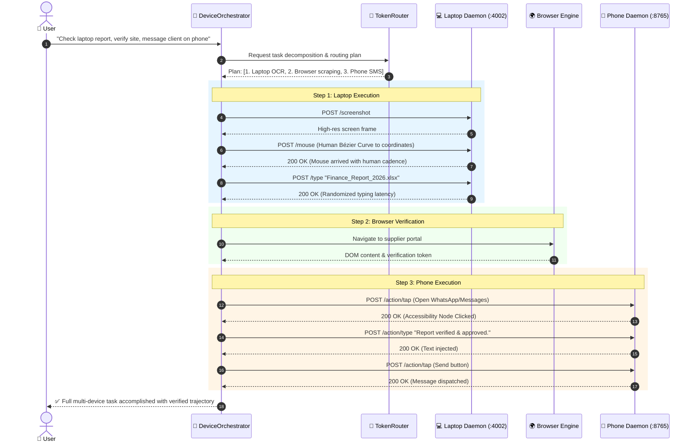
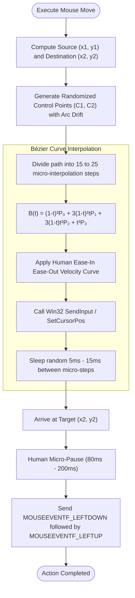
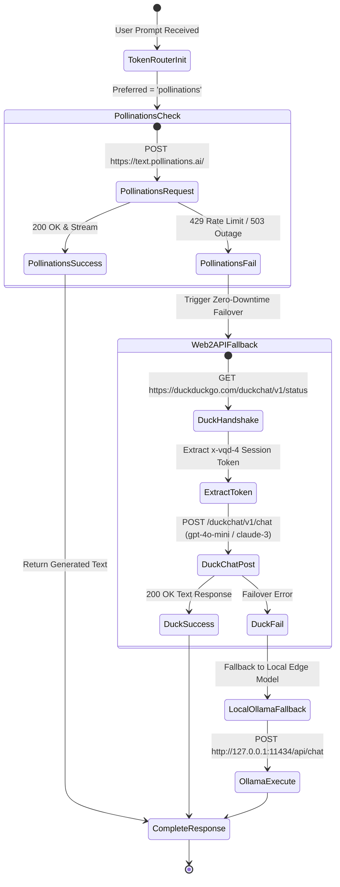
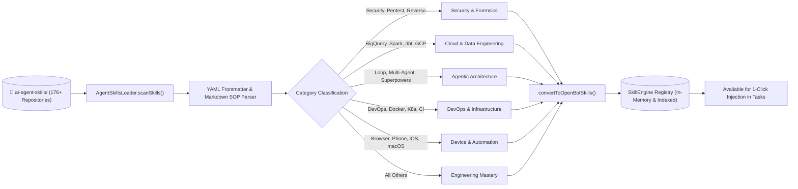

# OpenBot: Architectural Flow Diagrams & Visual Blueprint 📊🗺️

Welcome to the comprehensive visual documentation and interactive system flow mapping of **OpenBot**. This document visually maps every critical pathway in the codebase, detailing data structures, communication protocols, state machines, and real-life analogies to make every subsystem effortless to understand.

---

## 1. High-Level Macro Architecture Flow

---

## 2. Cross-Device Autonomous Task Flow (Laptop ⇄ Phone ⇄ Browser)

### 💡 Real-Life Analogy
> Imagine an executive assistant who sits in your office. When you ask them: *"Review the quarterly balance sheet on my laptop, verify the supplier's website in Chrome, and send an approval confirmation via SMS on my phone"*, they don't do it with imaginary tools. They physically turn to the PC screen, move their hand along a natural human curve to open the spreadsheet, switch tabs to check the supplier's portal, and pick up the smartphone to tap the SMS app. OpenBot's `DeviceOrchestrator` does exactly this across digital edge sockets.

---

## 3. Laptop Win32 Native Control & Human-Like Kinematics

### 💡 Real-Life Analogy
> If a robotic hand instantly teleports a mouse from `(0,0)` to `(800, 600)` in 0 milliseconds, anti-bot security flags it immediately as automated fraud. A real human arm accelerates smoothly, follows a slight arc (a cubic Bézier curve), slows down before reaching the target button, and pauses slightly before clicking. OpenBot's `WindowsNativeDriver` and `OpenBot-Laptop-Edge.exe` incorporate these physics.

---

## 4. Free-Tier Zero-Token Cost Inference Engine (TokenRouter)

### 💡 Real-Life Analogy
> Think of an intelligent electricity generator for a hospital. When standard mains power (paid OpenAI API) isn't desired or fails, the generator instantly switches to solar panels (Pollinations.ai Free Text API). If the sun is blocked, it switches immediately to wind power (Web2API DuckDuckGo Free Engine) or local battery reserves (Local Ollama GGUF weights) with zero interruption to life support.

---

## 5. Agent Skills Dynamic Discovery & Ingestion Flow

